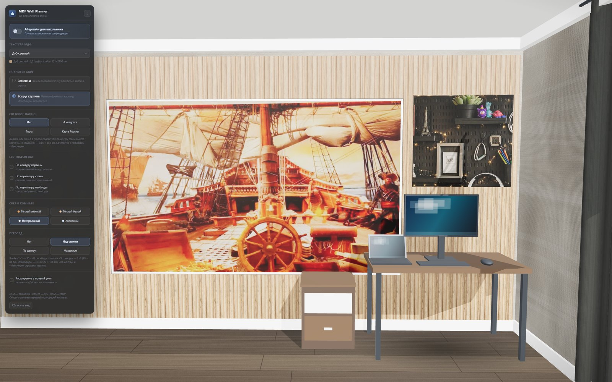
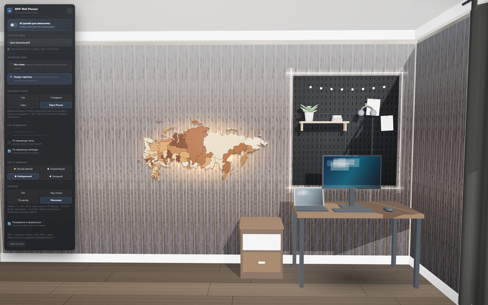

# MDF Wall Planner

**3D-визуализатор стены для подбора МДФ-панелей, пегборда и светового панно.**
Один автономный HTML-файл: открывается двойным щелчком, работает без сервера и сборки на стороне пользователя.



## Что умеет

- **4 декора МДФ** — Бетон Чикаго, Дуб светлый, Пекан, Орех Бразильский. Текстуры взяты из каталога, рейка ≈ 39,7 мм, рисунок непрерывный на стыках панелей.
- **2 режима покрытия** — «Вся стена» (панели закрывают стену, картина скрыта) и «Вокруг картины» (четыре панели обрамляют полотно 270 × 160 см).
- **Пегборд из ячеек 30 × 42 см** — «Над столом» (3 × 2), «По центру» (3 × 2, скрывает картину) и «Максимум» (4 × 3, опущен на одну ячейку).
- **Световое панно** — «4 квадрата» (38,5 × 38,5 см), «Горы» и «Карта России». Деревянная геометрия с тёплой подсветкой; «Максимум» сочетается с любым вариантом.
- **LED-подсветка** — по контуру картины, по периметру стены и по периметру пегборда. Недоступные комбинации блокируются автоматически.
- **4 сценария света** — тёплый жёлтый, тёплый белый, нейтральный и холодный.
- **Расширение в правый угол** — МДФ заходит на смежную стену.
- **AI-пресет** — готовая эргономичная конфигурация для школьника в один клик. Ручное изменение выключает пресет, а при повторном выключении возвращается состояние до его включения.
- **Свободная камера** — вращение, зум и панорамирование мышью (OrbitControls).

### «Максимум» вместе с панно «Карта России»



## Как открыть

1. Скачайте [`3droom.html`](3droom.html).
2. Откройте файл в браузере (Chrome, Edge, Firefox) — двойным щелчком или через `file://`.

Текстуры и данные встроены в файл, поэтому локальные пути не нужны. Для загрузки Three.js r147 с CDN при первом открытии требуется интернет.

## Реальные размеры сцены

| Объект | Размер |
| --- | --- |
| Стена | 490 × 270 см |
| Картина | 270 × 160 см |
| Стол | 125 × 75 см |
| Тумба (слева от стола) | 45 × 54 см |
| Ячейка пегборда | 30 × 42 см |
| Пегборд «Над столом» / «По центру» | 90 × 84 см (3 × 2) |
| Пегборд «Максимум» | 120 × 126 см (4 × 3), опущен на 42 см |
| Панно «4 квадрата» | 38,5 × 38,5 см |
| Панно «Горы» | 146 × 52 см |
| Панно «Карта России» | 152 × 72,4 см |

## Технологии

- Three.js **r147** (UMD) + `OrbitControls` и `RoomEnvironment` из `examples/js`.
- Один HTML-файл с inline CSS/JS; никаких сборщиков и зависимостей на runtime.
- Все текстуры — data URI (JPEG), чтобы `file://` не блокировал XHR и не портил WebGL-текстуры.
- Процедурная геометрия пегборда и светового панно; карта России собрана по контурам из `panno_rings.json`.
- UV МДФ в мировых координатах — паттерн реек не «прыгает» на границах панелей.

## Структура проекта

```
3droom.html          готовый автономный визуализатор
build.py             сборка: фрагменты + текстуры + данные → 3droom.html
_build/              исходники приложения по фрагментам part1…part7
panels/              текстуры МДФ и манифест (декоры, шаг рейки, UV)
tests/core.test.js   unit-тесты чистой логики (18 проверок)
docs/                изображения для README
_work/               служебные материалы и скриншоты (в git не входит)
```

Приложение собрано из упорядоченных фрагментов `_build/part1_head.html` … `part7_app4.html`; это не отдельные страницы, а части одного HTML-файла. Чистая логика раскладки вынесена в блок `/*==CORE-BEGIN==*/ … /*==CORE-END==*/` и не зависит от DOM и Three.js.

## Сборка и проверки

```bash
python build.py          # пересобрать 3droom.html
node tests/core.test.js  # 18 unit-тестов логики и геометрии
```

После сборки откройте `file:///…/3droom.html` и проверьте сцену вручную.

## Статус

Проект собран и проверен: все варианты декора, покрытия, пегбордов, панно, LED и световых пресетов работают, ошибок в консоли нет. Известных функциональных пробелов нет.

---

Репозиторий: [github.com/AlexOstrov/room_a](https://github.com/AlexOstrov/room_a)
